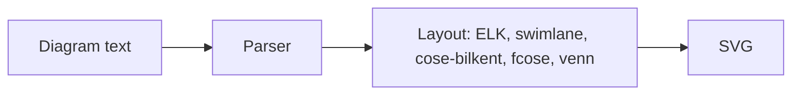

# ferrigura

ferrigura renders [Mermaid](https://github.com/mermaid-js/mermaid) diagram text to SVG in Rust, without a browser. It is a port of Mermaid 12.2.0 with all 33 of its diagram types: the same diagram text gives the same diagram, and the geometry of the output is checked against Mermaid run in Chromium.



## Using ferrigura

[crates/ferrigura/README.md](./crates/ferrigura/README.md) describes the library, [crates/ferrigura-cli/README.md](./crates/ferrigura-cli/README.md) the command-line tool, and [crates/ferrigura-node/README.md](./crates/ferrigura-node/README.md) the Node.js addon. The library and the command-line tool are on crates.io as [`ferrigura`](https://crates.io/crates/ferrigura) and [`ferrigura-cli`](https://crates.io/crates/ferrigura-cli); the addon is not published yet.

```sh
cargo add ferrigura
```

```sh
cargo install ferrigura-cli
```

## Repository layout

| Path                    | Contents                                                                                                                                                                                                              |
| ----------------------- | --------------------------------------------------------------------------------------------------------------------------------------------------------------------------------------------------------------------- |
| `crates/ferrigura`      | The library. The repository's root `Cargo.toml` is its package, so that one release covers the workspace                                                                                                              |
| `crates/ferrigura-cli`  | The command-line tool `ferrigura`                                                                                                                                                                                     |
| `crates/ferrigura-node` | The Node.js addon                                                                                                                                                                                                     |
| `crates/ferrigura-*`    | The parts: models and configuration (`model`), parsers (`syntax`), layout and SVG (`render`), text (`text`), and the layouts and math ported from their sources (`elk`, `cose`, `swimlane`, `venn`, `path`, `jsmath`) |
| `docs-port`             | The plan, the decisions, the status and the release process of the port; start with [docs-port/README.md](./docs-port/README.md) and [STATUS.md](./docs-port/STATUS.md)                                               |
| `tools/port`            | The harness that checks the port against the reference: models (`port:diff`) and geometry in Chromium (`port:geometry`)                                                                                               |
| `tools/release`         | `publish-crates.sh`, which publishes a release's crates by hand                                                                                                                                                       |
| `tools/reference`       | The reference the port is checked against: upstream Mermaid at a pinned commit, with patches, which `setup.sh` builds                                                                                                 |
| `e2e/diagrams`          | The `.mmd` corpus that the harness and the tests render; `e2e/platform/dev-diagrams` holds more inputs                                                                                                                |

## Development

The Rust toolchain is pinned by `rust-toolchain.toml` (stable, with clippy and rustfmt). The checks CI runs:

```bash
cargo fmt --all --check
```

```bash
cargo clippy --all-targets -- -D warnings
```

```bash
cargo test --workspace
```

The harness needs Node.js 22.12 or newer and pnpm, whose version `package.json` pins (with corepack: `corepack enable`). `tools/reference/setup.sh` builds the reference once, upstream Mermaid at the pin with its patches, in about half a minute; the harness takes it from `target/reference`.

```bash
pnpm install
```

```bash
tools/reference/setup.sh
```

```bash
pnpm port:diff flowchart
```

`pnpm port:diff <type>` compares the models of the Rust parsers with the reference's on every input of the type. `pnpm port:geometry <type>` renders the corpus with both and compares the geometry; it needs Chromium (`pnpm exec playwright install chromium`). `pnpm test` runs lint and the tests of the harness. [tools/port/README.md](./tools/port/README.md) lists every command.

Releases are made by release-please from the commit messages (`feat(…)`, `fix(…)`); [docs-port/RELEASE.md](./docs-port/RELEASE.md) describes the process.

## History

The repository started as a fork of Mermaid 12.2.0 that cleaned up the library, and keeps Mermaid's full history: the fork's commits sit on top of upstream commit `e28fbd9de` (the `develop` branch at 12.2.0). [FORK.md](./FORK.md) records what the fork removed from Mermaid. The port then took the fork as its reference, and later upstream Mermaid at a pinned commit; the fork left the repository then, and its last state is the tag `fork-mermaid-12.2.0`.

## License and credits

MIT, see [LICENSE](./LICENSE). Some crates port code or bundle fonts under the licences of their sources, which their `NOTICE.md` files list; `ferrigura-elk` is under EPL-2.0. Mermaid was created by Knut Sveidqvist and is maintained by the Mermaid contributors; all of their history is preserved in this repository.
