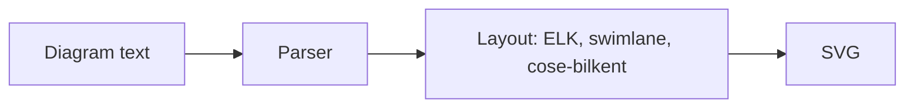

# ferraid

A fork of [Mermaid](https://github.com/mermaid-js/mermaid): generate diagrams from Markdown-like text.

The fork starts from Mermaid 12.2.0 and keeps its full history. Its first goal is a smaller core: everything that isn't the library itself goes, and so does every API, config option, keyword or code path that upstream has deprecated or that nothing reaches any more. [FORK.md](./FORK.md) lists what was removed, how to migrate, and what is still up for discussion.

The npm package is still called `mermaid` for now, and the diagram syntax is Mermaid's, minus the removed aliases.



## Size compared with Mermaid 12.2.0

Measured on 15 October 2026 against upstream commit `e28fbd9de`, with both checkouts built by `pnpm build`. Compressed sizes use gzip level 9 and Brotli quality 11; 1 kB is 1,000 bytes.

|                                              | Mermaid 12.2.0 |  ferraid | Change |
| -------------------------------------------- | -------------: | -------: | -----: |
| `mermaid.min.js` (IIFE), minified            |        5.49 MB |  5.42 MB |  −1.3% |
| `mermaid.min.js` (IIFE), gzip                |       1,567 kB | 1,542 kB |  −1.6% |
| `mermaid.min.js` (IIFE), Brotli              |       1,177 kB | 1,157 kB |  −1.7% |
| ESM entry `mermaid.esm.min.mjs`, gzip        |        11.6 kB |  11.3 kB |  −2.4% |
| ESM entry and all lazy chunks, gzip          |       1,579 kB | 1,556 kB |  −1.5% |
| npm tarball of `mermaid`, packed             |        26.0 MB |  25.5 MB |  −2.0% |
| Library source lines, without tests and docs |        114,970 |  109,747 |  −4.5% |
| Workspace packages                           |              9 |        2 |     −7 |
| Packages resolved in `pnpm-lock.yaml`        |          2,409 |    1,280 |   −47% |
| Files tracked in the repository              |          4,272 |    3,762 |   −12% |
| Runtime dependencies of `mermaid`            |             23 |       23 |      0 |

So far the cleanup has mostly removed what surrounds the library: seven packages, the website and the tooling they needed, which halves what `pnpm install` resolves. The bundles are only about 2% smaller, and most of that comes from removing the dagre layout. Most of the dead code removed from the library was never bundled in the first place, because nothing imported it.

## Rust port

The fork is being ported to Rust as **ferrigura**: a library, a command-line tool and a Node.js addon that render diagram text to SVG without a browser. [docs-port/](./docs-port/README.md) holds the plan, the decisions and the status; the TypeScript implementation stays as the reference until each diagram type reaches parity.

## Using ferrigura

[crates/ferrigura/README.md](./crates/ferrigura/README.md) describes the library, [crates/ferrigura-cli/README.md](./crates/ferrigura-cli/README.md) the command-line tool, and [crates/ferrigura-node/README.md](./crates/ferrigura-node/README.md) the Node.js addon. The library and the command-line tool are on crates.io as [`ferrigura`](https://crates.io/crates/ferrigura) and [`ferrigura-cli`](https://crates.io/crates/ferrigura-cli); the addon is not published yet.

## Repository layout

| Path                        | Contents                                                                |
| --------------------------- | ----------------------------------------------------------------------- |
| `packages/mermaid`          | The library: diagram types, rendering, layouts, themes, config schema   |
| `packages/parser`           | Langium grammars used by the newer diagram types (`@mermaid-js/parser`) |
| `packages/mermaid/src/docs` | Markdown reference docs (source); `docs/` holds the generated copy      |
| `e2e`                       | Playwright rendering tests and `.mmd` fixtures                          |

## Development

Requirements: Node.js 22.12 or newer and pnpm (the version is pinned in `package.json`).

```bash
pnpm install
```

```bash
pnpm dev
```

`pnpm dev` starts the dev server with live rebuilds; its root redirects to the diagram explorer at `/dev/`. To try a diagram of your own, save it as a `.mmd` file under `e2e/platform/dev-diagrams/` and pick it there.

```bash
pnpm test
```

`pnpm test` runs lint and the Vitest unit tests. `pnpm e2e` runs the Playwright suite; on the first run it records local screenshot baselines under `e2e/__snapshots__/`, and later runs compare against them.

```bash
pnpm build
```

`pnpm build` writes the ESM, core and IIFE bundles to `packages/mermaid/dist`.

## Following upstream

The upstream repository is the `upstream` remote. The fork's commits sit on top of upstream commit `e28fbd9de` (the `develop` branch at 12.2.0), so upstream fixes can be cherry-picked or merged.

```bash
git fetch upstream
```

## License and credits

MIT, see [LICENSE](./LICENSE). Mermaid was created by Knut Sveidqvist and is maintained by the Mermaid contributors; all of their history is preserved in this repository.
