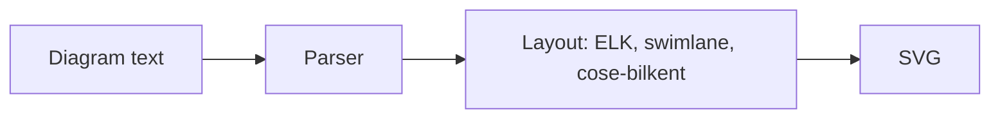

# ferraid

A fork of [Mermaid](https://github.com/mermaid-js/mermaid): generate diagrams from Markdown-like text.

The fork starts from Mermaid 12.2.0 and keeps its full history. Its first goal is a smaller core: everything that isn't the library itself goes, and so does every API, config option, keyword or code path that upstream has deprecated or that nothing reaches any more. [FORK.md](./FORK.md) lists what was removed, how to migrate, and what is still up for discussion.

The npm package is still called `mermaid` for now, and the diagram syntax is Mermaid's, minus the removed aliases.



## Repository layout

| Path                        | Contents                                                                |
| --------------------------- | ----------------------------------------------------------------------- |
| `packages/mermaid`          | The library: diagram types, rendering, layouts, themes, config schema   |
| `packages/parser`           | Langium grammars used by the newer diagram types (`@mermaid-js/parser`) |
| `packages/mermaid/src/docs` | Markdown reference docs (source); `docs/` holds the generated copy      |
| `e2e`                       | Playwright rendering tests and `.mmd` fixtures                          |
| `demos`                     | Pages served by the dev server for manual testing                       |

## Development

Requirements: Node.js 22.12 or newer and pnpm (the version is pinned in `package.json`).

```bash
pnpm install
```

```bash
pnpm dev
```

`pnpm dev` starts the dev server with live rebuilds. Open `/dev/` for the diagram explorer, or the root for the demo pages.

```bash
pnpm test
```

`pnpm test` runs lint and the Vitest unit tests. `pnpm e2e` runs the Playwright suite; on the first run it records local screenshot baselines under `e2e/__snapshots__/`, and later runs compare against them.

```bash
pnpm build
```

`pnpm build` writes the ESM, core and IIFE bundles to `packages/mermaid/dist`.

## Following upstream

The upstream repository is the `upstream` remote. The fork's commits sit on top of upstream commit `e28fbd9de` (the `develop` branch at 12.2.0), so upstream fixes can be cherry-picked or merged.

```bash
git fetch upstream
```

## License and credits

MIT, see [LICENSE](./LICENSE). Mermaid was created by Knut Sveidqvist and is maintained by the Mermaid contributors; all of their history is preserved in this repository.
