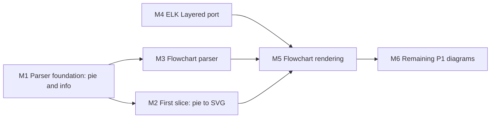

# ferrigura: porting the core to Rust

This folder holds the plan, the decisions and the status of porting this Mermaid fork to Rust. The port is called **ferrigura** (Latin _ferrum_ and _figura_), a working name until a trademark check at DPMA, EUIPO and USPTO clears it before the first release. The repository is [`sebastian-software/ferrigura`](https://github.com/sebastian-software/ferrigura); the local checkout may still be called `ferraid`. Crate names, Rust code and these documents use `ferrigura` throughout.

The root `docs/` folder is generated by `pnpm --filter mermaid docs:build`, which deletes and rebuilds it, so port documents live here instead.

| File                                       | Contents                                                                                   |
| ------------------------------------------ | ------------------------------------------------------------------------------------------ |
| [README.md](./README.md)                   | Goal, scope, architecture, test strategy, milestones                                       |
| [STATUS.md](./STATUS.md)                   | Progress per milestone, diagram type and strand; the handover                              |
| [canonical-model.md](./canonical-model.md) | Conventions of the canonical model: text, sanitisation, title precedence, what is left out |
| [decisions/](./decisions/)                 | One short record per hard-to-reverse decision                                              |
| [elk/](./elk/)                             | M4: the ELK source pin, Mermaid's option set and the port plan                             |
| [M6-PLAN.md](./M6-PLAN.md)                 | M6: the remaining P1 diagram types; per type `<type>/NOTES.md` and `<type>/PLAN.md`        |
| [../GLOSSARY.md](../GLOSSARY.md)           | Terms used across the fork and the port                                                    |

## Goal

A complete Rust implementation that renders Mermaid diagram text to SVG without a browser. The existing TypeScript implementation stays in the repository as the [JS reference](../GLOSSARY.md) until a diagram type reaches parity, and is then removed diagram by diagram.

**Delivered as**

- a Rust library with one entry point, `render(text, config) → svg`,
- a command-line tool,
- an npm package for Node.js, built with napi-rs as a native addon with prebuilt binaries per platform.

**Not delivered:** a browser build, WebAssembly, PNG output, or the JavaScript API (`initialize`, `run`, `parse`, `render` with callbacks). See [0001](./decisions/0001-rust-only-no-browser.md).

**Compatibility promise:** the same diagram text renders the same diagram. Configuration options carry over where they mean something without a browser. The programming interface is new and minimal.

## Scope

Diagram types are ported in tiers. Tier 3 is not ported by us: each type gets a GitHub issue labelled `help wanted` that points at its grammar, specs and fixtures. Types nobody ports disappear when the JS reference is removed.

| Tier | Diagram types                                                                                                                   |
| ---- | ------------------------------------------------------------------------------------------------------------------------------- |
| P1   | flowchart, sequence, class, state, ER, gantt, pie, timeline, gitGraph, journey, info                                            |
| P2   | mindmap, block, packet, xychart, sankey, quadrantChart, requirement, C4, kanban, architecture, treemap, ishikawa, eventmodeling |
| P3   | radar, treeView, venn, wardley, cynefin, usecase, swimlane, agentflow, railroad (with its EBNF, ABNF and PEG variants)          |

**Out of scope or deferred**

- **Math in labels** (`$$…$$`, KaTeX): out of scope, a `help wanted` issue. Typesetting formulas as SVG is a project of its own.
- **Hand-drawn look** (`look: handDrawn`): a later, optional post-processing step on finished geometry (P3), based on a Rust port of rough.js.
- **Runtime interactivity:** links stay as SVG `<a>`, tooltips become native SVG `<title>`, JavaScript callbacks go away. `securityLevel` shrinks to escaping text safely.
- **HTML labels** (`htmlLabels`, `foreignObject`): replaced by SVG text, see [0004](./decisions/0004-svg-text-labels.md).
- **Mindmap layout:** decided when P2 starts, between an own tree or radial layout and a port of cose-bilkent.

## Architecture

A Cargo workspace under `crates/`, next to the TypeScript packages. Diagram types are modules inside these crates, not crates of their own.

| Crate              | Responsibility                                           | License |
| ------------------ | -------------------------------------------------------- | ------- |
| `ferrigura-syntax` | Shared lexer base and the parsers of all diagram types   | MIT     |
| `ferrigura-model`  | Diagram models, configuration, themes                    | MIT     |
| `ferrigura-text`   | Fonts, text measurement, line breaking                   | MIT     |
| `ferrigura-elk`    | ELK Layered, ported from the Java sources                | EPL-2.0 |
| `ferrigura-render` | Layout integration and SVG output                        | MIT     |
| `ferrigura`        | Public facade: `render(text, config) → svg`              | MIT     |
| `ferrigura-cli`    | Command-line tool                                        | MIT     |
| `ferrigura-node`   | Node.js addon (napi-rs), published to npm as `ferrigura` | MIT     |

**Building blocks**

- **Parsing:** `logos` for lexing, hand-written recursive descent for the grammar, one shared base for common rules such as `title`, `accTitle` and `accDescr`. The Jison and Langium grammars stay in the repository as the specification. See [0002](./decisions/0002-hand-written-parsers.md).
- **Configuration:** Rust types generated by `build.rs` from `packages/mermaid/src/schemas/config.schema.yaml` as serde structs with defaults; the YAML stays the single source, trimmed of what has no meaning without a browser.
- **Labels:** Markdown in labels is parsed by Ferromark and written as styled `tspan` runs.
- **Text:** `harfrust` for shaping, the `read-fonts` model for metrics, and a port of Mermaid's own label wrapping with `unicode-segmentation` for graphemes. Only text is measured; every other size is calculated. See [0005](./decisions/0005-text-measurement-and-fonts.md) and the [text measurement spike](./spikes/text-measurement.md).
- **Fonts:** Lexica Ultralegible (four styles) and Atkinson Hyperlegible Mono for code are bundled, both under the SIL Open Font License. The glyphs a diagram uses are embedded as a subset by default; further fonts can be registered, with a fallback chain and a warning for missing glyphs.
- **Layout:** ELK Layered only, plus Mermaid's own ELK integration (`rendering-util/layout-algorithms/elk/render.ts`). The other ELK algorithms fall back to Layered with a warning. See [0006](./decisions/0006-elk-layered-port.md).
- **Themes:** CSS custom properties with attribute fallback; `redux-color` and `redux-dark-color` ship first; `colorScheme: light | dark | auto`. See [0007](./decisions/0007-themes-as-css-variables.md).

## Test strategy

The port is driven by tests that already exist, so progress is measured, not estimated. See [0003](./decisions/0003-differential-testing.md).

1. **Specs, ported one to one.** Every TypeScript spec file gets a Rust counterpart with the same test names, translated mechanically first. Tests that cannot pass yet are marked `#[ignore = "port: <reason>"]`, so the suite stays green while the count of ignored tests shows the remaining work. A script counts ported, ignored and passing tests per diagram type and writes them to STATUS. Tests that assert the exact Jison error text are changed to assert that parsing fails and where.
2. **Differential parsing.** A small exporter per diagram type turns the JS diagram DB into the [canonical model](../GLOSSARY.md), the same JSON the Rust model serializes to. Every input we have (e2e fixtures, spec inputs, documentation examples) goes through both, and any difference is a reproducible case.
3. **Differential layout for ELK.** The ELK port and elkjs receive the same ELK JSON graph; coordinates are compared.
4. **Geometry comparison for rendering.** Pixel equality with the JS output is impossible once fonts and label technique differ. The JS reference runs with `htmlLabels: false` and the bundled font loaded as a web font, and node positions and sizes, edge points and label boxes are compared within a small tolerance, plus visual review of samples.

## Milestones

| Milestone | Deliverable                                                                                                                                                          | Done when                                                                                                  |
| --------- | -------------------------------------------------------------------------------------------------------------------------------------------------------------------- | ---------------------------------------------------------------------------------------------------------- |
| M1        | Cargo workspace, CI job, lexer base and shared rules, pie and info parsers and models, their specs ported, JS exporters, the differential harness, the STATUS script | Ported pie and info specs pass; the differential run over all pie and info inputs shows no difference      |
| M2        | Text measurement, bundled fonts, themes as CSS variables, SVG output for pie, the CLI and the Node addon                                                             | `ferrigura` renders every pie fixture; the geometry comparison is within tolerance                         |
| M3        | Flowchart parser and model; the flowchart specs ported                                                                                                               | Flowchart parser specs pass; the differential run over all flowchart inputs shows no difference            |
| M4        | `ferrigura-elk`: ELK Layered ported from Java                                                                                                                        | The ELK differential run against elkjs is within tolerance on the graphs Mermaid produces for its fixtures |
| M5        | Flowchart rendering on ELK, including Mermaid's ELK integration                                                                                                      | The geometry comparison over the flowchart fixtures is within tolerance                                    |
| M6        | The remaining P1 diagram types                                                                                                                                       | Each P1 type passes its specs, the differential parse and the geometry comparison                          |

M1 comes first, because it builds the shared infrastructure. After M1, M2 and M3 run in parallel. M4 is independent and starts on day one. M5 needs M2, M3 and M4.

## Working mode

- Each parallel strand runs as its own session in its own worktree; the ELK port is a separate strand from the start.
- [STATUS.md](./STATUS.md) is the handover. A session updates its section when it stops, including what is next and what blocks it.
- A hard-to-reverse decision gets a record in [decisions/](./decisions/), numbered in sequence.
- A strand merges to `main` when its package is green.
- CI is one GitHub Actions workflow with a JS job (as long as the reference exists), a Rust job (`cargo fmt`, `clippy`, `test`) and the differential job.

## Conventions

- Rust edition 2024, `rust-version = "1.95"`, as in `ferromark`.
- License MIT, as Mermaid, for every crate except `ferrigura-elk`, which is EPL-2.0.
- Releases with release-please.
- Repository language is English.
