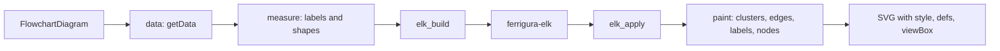

# M5: flowchart rendering

M5 renders flowcharts to SVG: the parsed model (M3) goes through Mermaid's `getData`, the shapes and labels are measured, ELK Layered (M4) lays them out, Mermaid's ELK post-processing places edges and labels, and the SVG is written with the themes and fonts of M2. The research behind this plan is in [render-notes/](./render-notes/); every rule there cites the reference file and line.

**Done when** the geometry comparison (`pnpm port:geometry-flowchart`) is within tolerance on every comparable flowchart fixture. Fixtures are excluded only with a named reason, as the empty pie is in M2.

## Decisions

| Question          | Decision                                                                                                                                                                                                                                                                          | Why                                                                                                                                                                                                                                                                                 |
| ----------------- | --------------------------------------------------------------------------------------------------------------------------------------------------------------------------------------------------------------------------------------------------------------------------------- | ----------------------------------------------------------------------------------------------------------------------------------------------------------------------------------------------------------------------------------------------------------------------------------- |
| Which look        | `neo` first, `classic` second. Both are ported in every shape; they differ mostly in padding constants and CSS. `handDrawn` is out of scope (P3)                                                                                                                                  | The flowchart section defaults to `look: neo` and `theme: redux-color` (`config.schema.yaml` 2455-2460), so neo is what a default flowchart looks like. No fixture sets `classic` explicitly                                                                                        |
| Comparison setup  | The harness inserts `%%{init: {"htmlLabels": false, "fontFamily": "\"Lexica Ultralegible\"", "securityLevel": "strict"}}%%` after the front matter, into the text both sides get. Theme and look stay as the fixture and the defaults set them                                    | ferrigura always draws SVG text with the bundled font (decisions 0004 and 0005); the reference must do the same to be comparable. A fixture's own `htmlLabels: true` or `fontFamily` would otherwise switch it back                                                                 |
| Excluded fixtures | `look: handDrawn` (50); a non-layered `layout` (`elk.box`, `elk.rectpacking`, `elk.stress`, ...), which ferrigura draws with layered and a warning (decision 0006)                                                                                                                | Out of scope, or no reference geometry to compare with                                                                                                                                                                                                                              |
| rough.js          | Shapes that the reference draws through rough.js at roughness 0 (stadium, rect_left_inv_arrow, forkJoin, filledCircle, anchor, stateEnd) get a deterministic path with the same geometry: the sampled points as `M`/`L` for line shapes, rough.js's own ellipse curve for circles | At roughness 0 the geometry is fixed, but rough.js doubles every stroke and draws its split points from `Math.random()` (`handDrawnSeed` 0), so its `d` differs from run to run. The bounding box, which feeds the layout, must match (rough circles overshoot: 14.0133 for d = 14) |
| Labels            | SVG text as the reference writes it with `htmlLabels: false`: one `tspan.text-outer-tspan` per line, one `tspan.text-inner-tspan` per word. Every run gets an explicit `x` and `text-anchor` start                                                                                | Decision 0004 and the WebKit finding of decision 0005                                                                                                                                                                                                                               |
| Markdown          | Parsed with Ferromark, mapped to what the reference's SVG path keeps: paragraphs, soft breaks, `strong`, `em` and inline HTML as words; codespan, links, strikethrough, escapes, images and hard breaks are dropped; other blocks become their raw source as one word             | Identical lines and words to the reference (`handle-markdown-text.ts`, probed in labels notes §7)                                                                                                                                                                                   |
| Node DOM ids      | `<svgId>-flowchart-<id>-<n>` with the reference's counter, which counts every `addVertex` call                                                                                                                                                                                    | Users style and script nodes by these ids; the gaps are part of the contract                                                                                                                                                                                                        |
| `data-points`     | Not written                                                                                                                                                                                                                                                                       | It serves the reference's line-jump pass in the browser; the harness samples `d` instead                                                                                                                                                                                            |
| Curve             | Routed ELK edges are drawn `rounded`, as in the reference (`elk/render.ts` 2078); `flowchart.curve` affects only the straight fallback                                                                                                                                            | Reference behaviour                                                                                                                                                                                                                                                                 |

## Pipeline

1. **data** (`flowDb.ts` `getData`): nodes in the reference's order (subgraphs first, in reverse closing order, then vertices), edges in creation order, every field the renderer reads.
2. **prepare** (`applyElkEdgeRenderData`): arrow types, classes, styles and curve per edge.
3. **measure** (`createGraphWithElements`): each leaf node's label is laid out and its shape drawn; the node's size is the union box of shape and label. Group labels are measured unwrapped (unless Markdown); edge labels are measured with their background padding.
4. **elk_build** (`buildElkGraphFromLayoutData`): the elkjs JSON graph and the side tables the post-processing needs.
5. **layout**: `ferrigura_elk::layout`.
6. **elk_apply** (`applyElkLayoutResult`, `applyElkEdgeLayout` and helpers, `geometry.ts`): absolute positions, group frames pulled in, edge points clipped at the node outlines, marker guards, straightening, label passes.
7. **paint**: groups first, then edges with their labels, then nodes; line hops after paint (`lineHops.ts`, `lineJump.ts`).
8. **svg**: style (decision 0007), font faces, markers and look defs, title, viewBox from the painted bounding box plus `diagramPadding`.

## Modules

All under `crates/ferrigura-render/src/flowchart/`. The shared types live in `mod.rs`, `geom.rs`, `data.rs`, `label.rs` and `shapes/mod.rs` and are fixed by the scaffold; a module's owner may add to them but not change what others use without the coordinator.

| Module                                               | Ports                                                                                                   | Notes                                                                      |
| ---------------------------------------------------- | ------------------------------------------------------------------------------------------------------- | -------------------------------------------------------------------------- |
| `mod.rs`                                             | `flowRenderer-v3-unified.ts`, `render.ts`, `common/index.ts`, `createGraph.ts`                          | Pipeline; coordinator                                                      |
| `geom.rs`                                            | `types.ts` `Point`, boxes                                                                               | Shared                                                                     |
| `data.rs`                                            | `flowDb.ts` `getData`, `destructEdgeType`, `getCompiledStyles`                                          | [getdata.md](./render-notes/getdata.md)                                    |
| `label.rs`, `markdown.rs`                            | `createText.ts`, `handle-markdown-text.ts`, `splitText.ts`                                              | [labels.md](./render-notes/labels.md); styled wrapping in `ferrigura-text` |
| `shapes/`                                            | `nodes.ts`, `shapes/*.ts`, `intersect/*`                                                                | [shapes-core.md](./render-notes/shapes-core.md)                            |
| `elk_build.rs`                                       | `elk/render.ts` up to `runElkLayout`, `subgraphFeedbackEdges.ts`, `find-common-ancestor.ts`             | [elk-build.md](./render-notes/elk-build.md)                                |
| `elk_apply.rs`, `elk_geometry.rs`                    | `elk/render.ts` from `applyElkLayoutResult`, `elk/geometry.ts`                                          | [elk-apply.md](./render-notes/elk-apply.md)                                |
| `edges.rs`, `markers.rs`, `path.rs`, `line_jumps.rs` | `edges.js`, `edgeMarker.ts`, `markers.js`, `lineJump.ts`, `elk/lineHops.ts`, `utils/lineWithOffset.ts`  | [edges.md](./render-notes/edges.md)                                        |
| `clusters.rs`                                        | `clusters.js` (the `rect` cluster)                                                                      | [labels.md](./render-notes/labels.md) §13                                  |
| `style.rs`                                           | `flowchart/styles.ts`, the shared rules of `styles.ts`, `insertLookDefs.ts`, class and style statements | [styles.md](./render-notes/styles.md)                                      |

## Stages

| Stage | Content                                                                                                                                                                                                                                                   | Fixtures                               |
| ----- | --------------------------------------------------------------------------------------------------------------------------------------------------------------------------------------------------------------------------------------------------------- | -------------------------------------- |
| A     | Every module for the core shapes (squareRect, roundedRect, stadium, question, circle, doublecircle, hexagon, the lean and trapezoid shapes, subroutine, cylinder, rect_left_inv_arrow, text), plain and string labels, edges without labels, no subgraphs | Stage 1 of the harness (13) and 1a (7) |
| B     | Subgraphs and their frames, edge labels, Markdown labels, classDef, style and linkStyle, the title                                                                                                                                                        | Stage 2 (28) and 1b (11)               |
| C     | The remaining shapes, icons and images, line hops on every path, collapsed subgraphs, the long tail of the fixtures                                                                                                                                       | The rest                               |

## Verification

- **Unit tests per module**, ported from the reference specs where they exist (`flowDb.spec.ts` getData cases, `flow-node-data.spec.js`, `shapes/*.spec.ts`, `edges.spec.js`, `lineJump.spec.ts`, `createText.spec.ts`, `clusters.spec.ts`), with the reference's test names.
- **ELK input differential.** `pnpm port:geometry-flowchart --capture` stores the graph the reference hands to elkjs for every fixture; the example `ferrigura --example flowchart-elk` prints ferrigura's, and the harness compares ids, order, sizes (0.05 px) and options (exact). This isolates measurement and graph construction from the post-processing.
- **Geometry comparison** of the final SVG: viewBox, node centres and boxes, edge paths sampled along their length, markers, edge label boxes, cluster frames; 0.05 px.
