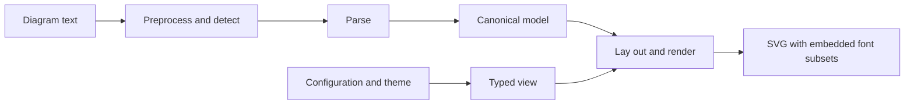

# Architecture

ferrigura renders Mermaid diagram text to SVG in Rust, without a browser ([0006](./decisions/0006-rust-only-no-browser.md)). This page is the map: what happens to a diagram, which crate does it, and where each part is decided. The reasons are in the [decisions](./decisions/README.md); what was learned along the way is in [LEARNINGS.md](./LEARNINGS.md); each diagram type has its page under [diagrams/](./diagrams/README.md).

## From text to SVG

1. **Preprocess and detect** (`ferrigura-syntax`): line endings are normalized, the YAML front matter and the `%%{init}%%` directives are read, and the detector picks the diagram type from the start of the text.
2. **Parse** (`ferrigura-syntax`): a hand-written parser per diagram type fills a DB that follows Mermaid's diagram DB ([0007](./decisions/0007-hand-written-parsers.md)).
3. **Model** (`ferrigura-model`): the DB's state as the canonical model of the type, the form the harness compares with the reference ([0008](./decisions/0008-canonical-model-and-typed-views.md), [canonical-model.md](./canonical-model.md)).
4. **Configuration and theme** (`ferrigura-model`, `ferrigura`): defaults per process, the site configuration and theme per `Renderer`, the diagram's front matter and directives per render; the renderer receives a typed, read-only `Context` ([0008](./decisions/0008-canonical-model-and-typed-views.md), [0011](./decisions/0011-themes-as-css-variables.md)).
5. **Lay out and render** (`ferrigura-render`): either a renderer of the type's own (sequence, gantt, pie, timeline and the other chart-like types) or the unified renderer, which builds the layout data as Mermaid's `getData()` does and lays it out with one of the ported engines ([0012](./decisions/0012-layout-engines-ported-exactly.md)).
6. **Text** (`ferrigura-text`): every label is measured and wrapped with the bundled fonts, written as SVG text, and the glyphs used are embedded as font subsets ([0009](./decisions/0009-svg-text-labels.md), [0010](./decisions/0010-text-measurement-and-fonts.md)).

The facade, `ferrigura`, ties it together: `Renderer::new(config)` resolves the configuration once, `renderer.render(text)` returns the SVG, and `ferrigura::render(text, config)` is the shorthand.

## Crates

A Cargo workspace under `crates/`. Diagram types are modules inside the crates, not crates of their own.

| Crate                | Does                                                                                                                        | License                                                 |
| -------------------- | --------------------------------------------------------------------------------------------------------------------------- | ------------------------------------------------------- |
| `ferrigura`          | The facade: `Renderer`, `render`, `RenderOptions`; the repository's root package                                            | MIT                                                     |
| `ferrigura-cli`      | The command-line tool `ferrigura`                                                                                           | MIT                                                     |
| `ferrigura-node`     | The Node.js addon (napi-rs), published through npm, not crates.io ([0016](./decisions/0016-npm-packages-via-napi.md))       | MIT                                                     |
| `ferrigura-syntax`   | Preprocessing, detection, the lexers and parsers of every diagram type, YAML, sanitization                                  | MIT                                                     |
| `ferrigura-model`    | The canonical models, the configuration (generated from `schema/config.schema.yaml` by `build.rs`), themes and tokens       | MIT                                                     |
| `ferrigura-render`   | The renderers, the unified renderer (shapes, clusters, edges, the ELK glue, the tidy tree), the Markdown reader, SVG output | MIT                                                     |
| `ferrigura-text`     | Fonts, measurement, wrapping, subsetting; the bundled faces                                                                 | MIT AND OFL-1.1 AND CC-BY-4.0                           |
| `ferrigura-elk`      | ELK Layered, ported from Java                                                                                               | EPL-2.0                                                 |
| `ferrigura-cose`     | cose-bilkent and fcose                                                                                                      | MIT                                                     |
| `ferrigura-swimlane` | Mermaid's swimlane layout                                                                                                   | MIT                                                     |
| `ferrigura-venn`     | The layout of `@upsetjs/venn.js`                                                                                            | MIT                                                     |
| `ferrigura-jsmath`   | JavaScript's `Math` as V8 computes it, bit for bit                                                                          | MIT AND Apache-2.0 WITH LLVM-exception AND BSD-3-Clause |
| `ferrigura-path`     | Chromium's bounding box of an SVG path, bit for bit                                                                         | MIT AND BSD-3-Clause                                    |

Licenses follow the sources of the ported code ([0013](./decisions/0013-licenses-of-ported-code.md)); each crate that ports or bundles anything lists it in its `NOTICE.md`.

## Around the crates

| Path              | Holds                                                                                                                                                                                                                 |
| ----------------- | --------------------------------------------------------------------------------------------------------------------------------------------------------------------------------------------------------------------- |
| `node/`           | The npm packages: the facade `@ferrigura/core` and the platform packages ([0016](./decisions/0016-npm-packages-via-napi.md))                                                                                          |
| `tools/port`      | The harness: the differential runs against the reference, the geometry runs in Chromium, the corpus capture tools, and the lint and format setup of the repository ([0015](./decisions/0015-differential-testing.md)) |
| `tools/reference` | The pin, the patches and `setup.sh`, which build the reference ([0014](./decisions/0014-upstream-reference-at-a-pin.md))                                                                                              |
| `tools/snapshots` | `diff.sh`, which shows which renders a change moved                                                                                                                                                                   |
| `tools/release`   | `publish-crates.sh`, for publishing a release by hand ([0004](./decisions/0004-one-version-one-release.md))                                                                                                           |
| `e2e/diagrams`    | The fixtures: the `.mmd` corpus the harness and the tests render; `e2e/platform/dev-diagrams` holds more inputs                                                                                                       |

## Limits

What ferrigura does not do, on purpose or not yet:

- **Out of scope:** browsers and WebAssembly, raster output, Mermaid's JavaScript API and callbacks ([0006](./decisions/0006-rust-only-no-browser.md)); HTML labels and math in labels ([0009](./decisions/0009-svg-text-labels.md)); `look: handDrawn`; the dagre layout and the ELK algorithms other than Layered ([0012](./decisions/0012-layout-engines-ported-exactly.md)); Mermaid's classic themes ([0011](./decisions/0011-themes-as-css-variables.md)).
- **Not yet:** fallback fonts for the scripts the bundled faces do not cover (CJK, kana, Arabic, some emoji and symbols) must be registered by the user ([0010](./decisions/0010-text-measurement-and-fonts.md)); flowchart images and icon packs. The [diagram pages](./diagrams/README.md) list what each type still lacks.
