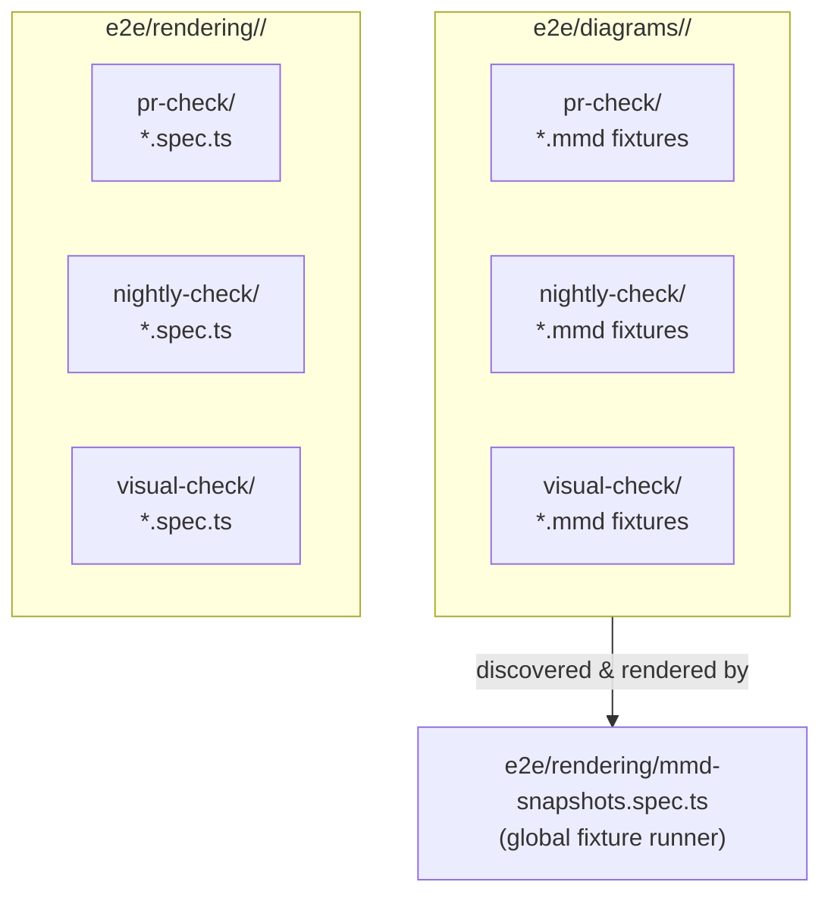

> **Warning**
>
> ## THIS IS AN AUTOGENERATED FILE. DO NOT EDIT.
>
> ## Please edit the corresponding file in [/packages/mermaid/src/docs/community/e2e-tests.md](../../packages/mermaid/src/docs/community/e2e-tests.md).

# E2E Test Suite: Tiers and Folders

This is a contributor-facing manual for the `e2e/` test suite's tier structure — why it exists, how it's organized, which environment variables control it, and how to work with it locally.

## Why this exists

Running every diagram, every theme variant, and every look/handdrawn combination for every change is thorough, but it is slow, and most changes touch one diagram type. Waiting on the full suite to validate a one-line fix is slow feedback for no real benefit.

The fix is to split fixtures and specs into **tiers** — a small, fast, curated set that runs for every change, and larger, slower sets reserved for less frequent, higher-confidence checks.

## Directory layout

Two parallel trees hold the suite's content:




- **`e2e/diagrams/<diagram-type>/<tier>/*.mmd`** — static Mermaid source fixtures. Each one is just a diagram (optionally with YAML frontmatter setting `config`/`title`/a `description`). They aren't run directly; a single global spec, `e2e/rendering/mmd-snapshots.spec.ts`, discovers every `.mmd` file under `e2e/diagrams/`, registers one Playwright test per fixture (grouped into `describe` blocks mirroring the folder path), and renders it. This is where the large majority of diagram-rendering coverage lives — no test-writing required, just add a `.mmd` file in the right tier folder.
- **`e2e/rendering/<diagram-type>/<tier>/*.spec.{js,ts}`** — hand-written Playwright specs, for anything a static fixture can't express: DOM/CSS assertions, `.click()` interactions, directive-vs-`initialize()` precedence checks, multi-diagram array tests, custom `mermaid.initialize()` config, and similar. If your test needs to assert on rendered output beyond "did it render without erroring," it belongs here instead of as a fixture.
- **`e2e/other/<tier>/*.spec.{js,ts}`** — cross-cutting specs that aren't about any single diagram type (XSS/security tests, GHSA regression tests, `iife`/embed tests, page-interaction tests, external-diagram loading). Only `pr-check/` is populated today.
- **`e2e/helpers/`** — shared test infrastructure: `util.ts` (the `imgSnapshotTest`/`renderGraph`/`verifyScreenshot` helpers every spec uses) and `mmd-snapshots.ts` (fixture discovery/metadata for the global runner).

Not every `<diagram-type>/<tier>/` directory has content yet — some are intentionally empty, left in place as containers for tests that haven't been written. An empty tier folder isn't stray or safe to delete; it's scaffolding for the layout above, matching a diagram type or tier that's expected to gain coverage later.

### The three tiers

| Tier            | Intent                                                                                                                                                                     |
| --------------- | -------------------------------------------------------------------------------------------------------------------------------------------------------------------------- |
| `pr-check`      | Small, curated, fast smoke set — one or two representative fixtures per feature, not an exhaustive sweep. Run it for every change.                                         |
| `nightly-check` | Bulk/comprehensive coverage — most of the fixture volume lives here. Run it periodically and before a release, alongside `pr-check`.                                       |
| `visual-check`  | Theme/look (`classic`/`neo`/`handDrawn`)/layout/direction combinatorial sweeps — the same diagram rendered across every variant. Pixel/appearance content, not parse-only. |

A fixture or spec's tier is purely a function of which subfolder it lives in — there's no separate registry or config file to update.

If you're new to this structure, here's how to decide where a new test belongs:

- **Adding a new diagram feature or syntax?** Add one small `pr-check` fixture covering the happy path — this is what every change runs, so it catches an obvious regression immediately. If the feature has several meaningfully different shapes/variants/edge cases worth covering, add those as additional fixtures under `nightly-check` instead of piling them all into `pr-check` — `pr-check` is meant to stay small and fast, not become exhaustive.
- **Fixing a rendering bug?** Add a `pr-check` fixture that reproduces the bug (the minimal diagram that triggered it), so this exact regression is caught on every future change. Only drop it into `nightly-check` instead if it's a narrow, rarely-hit edge case where running it for every change isn't worth the extra time.
- **Backfilling broad coverage for something that already works** (e.g. every node-shape × edge-type combination, a sweep of config options)? That bulk volume belongs in `nightly-check` — it's comprehensive by design and only needs to run now and then, not for every change.
- **Testing a purely visual/appearance difference** — how a diagram looks under a different theme, `handDrawn` look, layout direction, or similar, where the underlying structure/parsing is unaffected? That's `visual-check`. It's pixel/appearance content best reviewed by a human, not something an automated parse-only assertion can usefully judge.
- **Does your test need to assert on something beyond "did it render without erroring"?** — a DOM/CSS assertion, a `.click()` interaction, directive-vs-`initialize()` precedence, a multi-diagram array, custom `mermaid.initialize()` config — that can't be expressed as a static `.mmd` fixture. Write a hand-written spec instead, under `e2e/rendering/<diagram-type>/<tier>/*.spec.{js,ts}` if it's about one specific diagram type, or `e2e/other/<tier>/*.spec.{js,ts}` if it's cross-cutting (security/XSS, embed/`iife`, page interactions, external-diagram loading, and similar). The same tier logic above still applies to these — a fast smoke-test spec goes in `pr-check`, a more exhaustive one in `nightly-check`.

When in doubt, default to `pr-check` for anything a feature's author would want caught immediately, and move broader/slower coverage to `nightly-check`.

## Environment variables

| Name                                | Where                                    | Effect                                                                                                                                          |
| ----------------------------------- | ---------------------------------------- | ----------------------------------------------------------------------------------------------------------------------------------------------- |
| `MERMAID_E2E_FIXTURE_TIER`          | env var, read by `mmd-snapshots.spec.ts` | Comma-separated tier list (e.g. `pr-check`, or `pr-check,nightly-check`) that narrows which `.mmd` fixtures get registered. Unset = every tier. |
| `MERMAID_DEV_EXPLORER_ROOT`         | env var, read by `.esbuild/server.ts`    | Which `.mmd` root the local Dev Explorer (`/dev` route) serves. Defaults to `e2e` (the whole tree — fixtures, platform diagrams, everything).   |
| `MERMAID_PORT` / `MERMAID_DEV_PORT` | env var                                  | Overrides the dev server port Playwright/the dev server use.                                                                                    |
| `E2E_COVERAGE`                      | env var                                  | Switches the dev server to the coverage-instrumented build, and enables native V8 coverage collection during a Playwright run.                  |

## Working with tiers locally

**Run only the `pr-check` tier**:

```bash
MERMAID_E2E_FIXTURE_TIER=pr-check pnpm exec playwright test e2e/rendering/mmd-snapshots.spec.ts $(node scripts/e2e-tier-scope.mjs pr-check | tr ',' ' ')
```

**Run `pr-check`+`nightly-check` together**:

```bash
MERMAID_E2E_FIXTURE_TIER=pr-check,nightly-check pnpm exec playwright test e2e/rendering/mmd-snapshots.spec.ts $(node scripts/e2e-tier-scope.mjs pr-check nightly-check | tr ',' ' ')
```

**Compare screenshots.** The first run of a fixture writes its screenshot to `e2e/__snapshots__/` (git-ignored); later runs compare against it with Playwright's `toHaveScreenshot`. To see what a change does visually, run the tiers you care about once on a clean checkout, then again with your change.

## Diagrams and screenshots

The Dev Explorer (`/dev` route) — browse `.mmd` fixtures under the configured `MERMAID_DEV_EXPLORER_ROOT` and preview them rendered:


The flowchart above (directory layout) is a Mermaid diagram — edit it the same way you'd edit any diagram in this repo. If you add more diagrams to this doc, prefer Mermaid over static images where the content is structural/flow-based (it stays accurate as the suite evolves, and — fittingly for this repo — is easy for any contributor to update in a plain-text diff).
