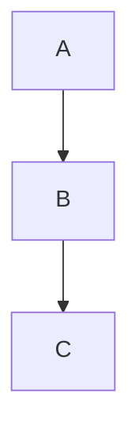

> **Warning**
>
> ## THIS IS AN AUTOGENERATED FILE. DO NOT EDIT.
>
> ## Please edit the corresponding file in [/packages/mermaid/src/docs/config/layouts.md](../../packages/mermaid/src/docs/config/layouts.md).

# Layouts

This page lists the available layout algorithms supported in Mermaid diagrams.

## ELK is bundled and default from v12.0.0

ELK is part of `mermaid` itself and registered automatically, so `layout: elk`
works with no setup — and since v12.0.0 it is the **default**, replacing Dagre.

`elk` is the new default layout for these diagrams:

- Flowchart
- State
- Class
- Entity relationship
- Requirement
- Use case
- Agentflow

To go back to the previous layout, use `layout: dagre`.

## Supported Layouts

- **elk** (default): [ELK (Eclipse Layout Kernel)](https://www.eclipse.org/elk/). Bundled with Mermaid; no setup required. Specific ELK algorithms can be selected as `elk.stress`, `elk.force`, `elk.mrtree`, `elk.sporeOverlap`, `elk.box`, and `elk.rectpacking`.
- **dagre**: Dagre layout for layered graphs
- **cose-bilkent**: Cose Bilkent layout for force-directed graphs

Mindmaps are the one diagram type not laid out with ELK by default; they use
cose-bilkent unless you ask for something else.

To add your own layout algorithm and register it with `registerLayoutLoaders`,
see the [Layout makers guide](../community/layout-makers-guide.md).

## How to Use

Since `elk` is the default, a diagram needs no configuration to use it. To pick
a different layout, set it in your diagram's YAML config or initialization
options. For example:

