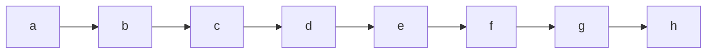
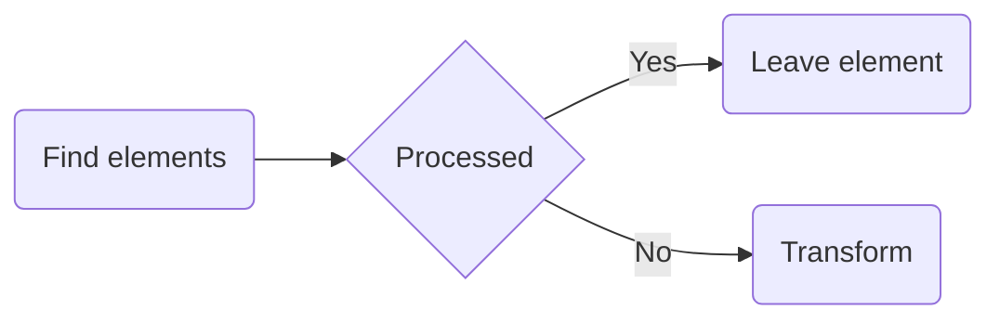

> **Warning**
>
> ## THIS IS AN AUTOGENERATED FILE. DO NOT EDIT.
>
> ## Please edit the corresponding file in [/packages/mermaid/src/docs/config/setup/mermaid/interfaces/Mermaid.md](../../../../../packages/mermaid/src/docs/config/setup/mermaid/interfaces/Mermaid.md).

[**mermaid**](../../README.md)

---

# Interface: Mermaid

Defined in: [packages/mermaid/src/mermaid.ts:368](https://github.com/mermaid-js/mermaid/blob/master/packages/mermaid/src/mermaid.ts#L368)

## Properties

### contentLoaded()

> **contentLoaded**: () => `void`

Defined in: [packages/mermaid/src/mermaid.ts:376](https://github.com/mermaid-js/mermaid/blob/master/packages/mermaid/src/mermaid.ts#L376)

\##contentLoaded Callback function that is called when page is loaded. If the `startOnLoad`
configuration is enabled, it calls [run](#run) to render the mermaid diagrams on the page.

#### Returns

`void`

---

### detectType()

> **detectType**: (`text`, `config?`) => `string`

Defined in: [packages/mermaid/src/mermaid.ts:377](https://github.com/mermaid-js/mermaid/blob/master/packages/mermaid/src/mermaid.ts#L377)

Detects the type of the graph text.

Takes into consideration the possible existence of an `%%init` directive

#### Parameters

##### text

`string`

The text defining the graph. For example:

##### config?

[`MermaidConfig`](MermaidConfig.md)

The mermaid config.

#### Returns

`string`

A graph definition key

---

### getRegisteredDiagramsMetadata()

> **getRegisteredDiagramsMetadata**: () => `Pick`<[`ExternalDiagramDefinition`](ExternalDiagramDefinition.md), `"id"`>\[]

Defined in: [packages/mermaid/src/mermaid.ts:379](https://github.com/mermaid-js/mermaid/blob/master/packages/mermaid/src/mermaid.ts#L379)

Gets the metadata for all registered diagrams.
Currently only the id is returned.

#### Returns

`Pick`<[`ExternalDiagramDefinition`](ExternalDiagramDefinition.md), `"id"`>\[]

An array of objects with the id of the diagram.

---

### initialize()

> **initialize**: (`config`) => `void`

Defined in: [packages/mermaid/src/mermaid.ts:375](https://github.com/mermaid-js/mermaid/blob/master/packages/mermaid/src/mermaid.ts#L375)

Used to set configurations for mermaid.
This function should be called before the run function.

#### Parameters

##### config

[`MermaidConfig`](MermaidConfig.md)

Configuration object for mermaid.

#### Returns

`void`

---

### parse()

> **parse**: {(`text`, `parseOptions`): `Promise`<`false` | [`ParseResult`](ParseResult.md)>; (`text`, `parseOptions?`): `Promise`<[`ParseResult`](ParseResult.md)>; }

Defined in: [packages/mermaid/src/mermaid.ts:370](https://github.com/mermaid-js/mermaid/blob/master/packages/mermaid/src/mermaid.ts#L370)

#### Call Signature

> (`text`, `parseOptions`): `Promise`<`false` | [`ParseResult`](ParseResult.md)>

Parse the text and validate the syntax.

##### Parameters

###### text

`string`

The mermaid diagram definition.

###### parseOptions

[`ParseOptions`](ParseOptions.md) & `object`

Options for parsing.

##### Returns

`Promise`<`false` | [`ParseResult`](ParseResult.md)>

An object with the `diagramType` set to type of the diagram if valid. Otherwise `false` if parseOptions.suppressErrors is `true`.

##### See

[ParseOptions](ParseOptions.md)

##### Throws

Error if the diagram is invalid and parseOptions.suppressErrors is false or not set.

#### Call Signature

> (`text`, `parseOptions?`): `Promise`<[`ParseResult`](ParseResult.md)>

Parse the text and validate the syntax.

##### Parameters

###### text

`string`

The mermaid diagram definition.

###### parseOptions?

[`ParseOptions`](ParseOptions.md)

Options for parsing.

##### Returns

`Promise`<[`ParseResult`](ParseResult.md)>

An object with the `diagramType` set to type of the diagram if valid. Otherwise `false` if parseOptions.suppressErrors is `true`.

##### See

[ParseOptions](ParseOptions.md)

##### Throws

Error if the diagram is invalid and parseOptions.suppressErrors is false or not set.

---

### parseError?

> `optional` **parseError**: [`ParseErrorFunction`](../type-aliases/ParseErrorFunction.md)

Defined in: [packages/mermaid/src/mermaid.ts:369](https://github.com/mermaid-js/mermaid/blob/master/packages/mermaid/src/mermaid.ts#L369)

---

### registerExternalDiagrams()

> **registerExternalDiagrams**: (`diagrams`, `opts`) => `Promise`<`void`>

Defined in: [packages/mermaid/src/mermaid.ts:374](https://github.com/mermaid-js/mermaid/blob/master/packages/mermaid/src/mermaid.ts#L374)

Used to register external diagram types.

#### Parameters

##### diagrams

[`ExternalDiagramDefinition`](ExternalDiagramDefinition.md)\[]

Array of [ExternalDiagramDefinition](ExternalDiagramDefinition.md).

##### opts

If opts.lazyLoad is false, the diagrams will be loaded immediately.

###### lazyLoad?

`boolean` = `true`

#### Returns

`Promise`<`void`>

---

### registerIconPacks()

> **registerIconPacks**: (`iconLoaders`) => `void`

Defined in: [packages/mermaid/src/mermaid.ts:378](https://github.com/mermaid-js/mermaid/blob/master/packages/mermaid/src/mermaid.ts#L378)

#### Parameters

##### iconLoaders

[`IconLoader`](../type-aliases/IconLoader.md)\[]

#### Returns

`void`

---

### registerLayoutLoaders()

> **registerLayoutLoaders**: (`loaders`) => `void`

Defined in: [packages/mermaid/src/mermaid.ts:373](https://github.com/mermaid-js/mermaid/blob/master/packages/mermaid/src/mermaid.ts#L373)

#### Parameters

##### loaders

[`LayoutLoaderDefinition`](LayoutLoaderDefinition.md)\[]

#### Returns

`void`

---

### render()

> **render**: (`id`, `text`, `svgContainingElement?`) => `Promise`<[`RenderResult`](RenderResult.md)>

Defined in: [packages/mermaid/src/mermaid.ts:371](https://github.com/mermaid-js/mermaid/blob/master/packages/mermaid/src/mermaid.ts#L371)

Renders the diagram, holding the diagram config scope for exactly as long as the render.
Leaving it set would make `getConfig()` report the last diagram's appearance as the
global answer for every caller between renders.

#### Parameters

##### id

`string`

##### text

`string`

##### svgContainingElement?

`Element`

#### Returns

`Promise`<[`RenderResult`](RenderResult.md)>

---

### run()

> **run**: (`options`) => `Promise`<`void`>

Defined in: [packages/mermaid/src/mermaid.ts:372](https://github.com/mermaid-js/mermaid/blob/master/packages/mermaid/src/mermaid.ts#L372)

## run

Function that goes through the document to find the chart definitions in there and render them.

The function tags the processed attributes with the attribute data-processed and ignores found
elements with the attribute already set. This way the run function can be triggered several
times.

Renders the mermaid diagrams

#### Parameters

##### options

[`RunOptions`](RunOptions.md) = `...`

Optional runtime configs

#### Returns

`Promise`<`void`>
