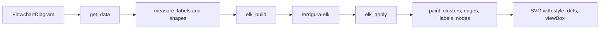

# Flowchart

A flowchart draws nodes of many shapes, the edges between them and subgraphs that group them. It starts with `graph`, `flowchart` or `flowchart-elk` and a direction. ferrigura parses it with the hand-written parser of `ferrigura-syntax` (`flowchart/`), keeps it in the canonical model of `ferrigura-model` (`flowchart.rs`), and draws it with the unified renderer of `ferrigura-render` (`flowchart/` for the diagram, `unified/` for the machinery it shares with class, state, ER and requirement diagrams). ELK Layered (`ferrigura-elk`) places the nodes. The [swimlane diagram](./swimlanes.md) reuses this parser, model and renderer, and so do the agentflow, which has its own scanner dialect and model.

This page is also the reference for the unified renderer. Other diagram types link to its sections for shapes, labels, edges, clusters and the ELK glue.

## Model

The model, `FlowchartDiagram`, is the state of the reference's flowchart DB (`flowDb.ts`) after the parse, with the DB's names in camelCase. [canonical-model.md](../canonical-model.md) holds the conventions that every model shares (the text rules, `""` for an absent string, `null` for an undefined field); the fields are these.

| Field                                | Holds                                                                                                      |
| ------------------------------------ | ---------------------------------------------------------------------------------------------------------- |
| `title`                              | The front matter title, or `""`. The grammar has no `title` statement.                                     |
| `accTitle`, `accDescr`               | The accessibility texts, with the flowchart's own whitespace rules (see below).                            |
| `direction`                          | `TB`, `BT`, `LR`, `RL`, or `BR` as written. `TD` is stored as `TB`.                                        |
| `vertices`                           | The nodes, in creation order.                                                                              |
| `edges`                              | The edges, in creation order.                                                                              |
| `subgraphs`                          | The subgraphs, in closing order.                                                                           |
| `classes`                            | The `classDef` entries, in the order they are first named.                                                 |
| `tooltips`                           | The tooltips set by `click`, in the order they are first set, keyed by id (the id need not name a vertex). |
| `defaultStyle`, `defaultInterpolate` | The styles and the interpolation of `linkStyle default`, `null` when none was given.                       |

A vertex has:

- `id`, `text` (the id when no label is given) and `labelType` (`text`, `string` for a double-quoted label, `markdown` for a quoted label between backticks);
- `shape` as written in the source (`square`, `round`, `db`, a name from `@{ shape: … }`), `null` when none was given;
- `styles` from `style` statements and `classes` (the `clickable` class that `click` adds is among them), both in order;
- `link` and `linkTarget` from `click … href`, `null` when absent or empty after trimming;
- `props` from `[|key:value|text]`;
- `icon`, `form`, `pos`, `img`, `constraint`, `assetWidth` and `assetHeight` from the shape data (`w` and `h` are read as JavaScript's `Number` reads them).

An edge has `id`, `isUserDefinedId`, `start`, `end` (a vertex or a subgraph id), `type` (`arrow_open`, `arrow_point`, `arrow_cross`, `arrow_circle`, the `double_` forms, or `INVALID`), `stroke` (`normal`, `thick`, `dotted`, `invisible`, or `INVALID`), `length` (at most 10, `null` for an `INVALID` link), `text`, `labelType`, `classes`, `style`, `interpolate`, and `animate` and `animation` from the edge's shape data. A subgraph has `id`, `title`, `labelType`, `nodes` (vertex and subgraph ids), `dir`, `classes` and `metadata` (the `@{ … }` keys as written). A class has `id` and `styles`, split as the DB splits them and not trimmed.

What the model keeps from the DB's quirks, so that the differential run sees them:

- **Order.** Vertices are in creation order and edges in the order of the DB's `edges` array. Subgraphs are in closing order, so a nested subgraph comes before its parent, and a repeated id merges into its first position and keeps that declaration's title and direction. A subgraph's `nodes` keep the grammar's order, in which a chain's later nodes come first: `A --> B --> C` gives `[C, B, A]`, and `A & B --> C` gives `[C, A, B]`.
- **Edge ids.** The `id` is always set: the user's `e1@` id when it is not used yet, else `L_<start>_<end>_<n>`. `n` is `0` for the first edge of a pair and the count of earlier edges plus one afterwards, so three edges `A --> B` get `0`, `2` and `3`. A user id goes only to the pair of the last start and the first end of a statement with several.
- **The vertex counter.** The DB counts every `addVertex` call, also the ones that find the vertex already there, and a new vertex keeps the count as its DOM id suffix (`flowchart-<id>-<n>`). The count is rendering state: it is not serialized, but `FlowVertex::dom_counter` carries it to the renderer, and the node ids in the SVG depend on it.
- **Merging.** A second mention of a vertex replaces its text and shape when given and appends its styles and classes. A subgraph id with shape data merges the data into the subgraph and makes no vertex. An edge id with shape data sets `animate`, `animation` and the interpolation of that edge.
- **Members of one subgraph only.** A node that another subgraph lists is removed from the earlier one, and a subgraph's own id is removed from its members.
- **Header texts.** `accTitle` is trimmed with its leading blanks removed. `accDescr`, block or single line, is trimmed and each line break with the blanks after it becomes one line break. Blank lines are not collapsed.
- **Sanitized texts.** The DB runs the text of a node, an edge and a subgraph title through the sanitizer (`sanitize.rs`, a port of the part of DOMPurify that these texts reach), so the model holds `AT&amp;T <b>bold</b>` for `AT&T <b>bold</b>`. The `@{ label }` text is not sanitized, as in the reference. Entities are encoded before the parse, so the model keeps the placeholder form (`fl°quot¶ß` for `#quot;`).
- **`dir` is subgraph-only.** The grammar never passes a direction to a vertex.
- **`click`.** A link is kept for the vertices that exist when the statement runs, so a `click` before the node is declared sets no link. A callback is not in the model, and only the `clickable` class it adds is.

Left out of the model: `maxEdges`, which is a parser option (`Options::max_edges`, 500), and `securityLevel`, `htmlLabels`, `inheritDir` and `curve`, which act at render time and are read from the configuration.

## Parsing

The parser is hand-written in `crates/ferrigura-syntax/src/flowchart/` ([0007](../decisions/0007-hand-written-parsers.md)). The reference's grammar is `flow.jison`, whose lexer has start conditions and takes the first matching rule, not the longest.

**Preprocessing.** `parse` takes the text through the steps the reference runs before the grammar sees it, in this order: the front matter (shared preparation), the directives, `cleanupComments` (the lines that start with `%%` and not `%%{`, and the leading blanks), the entity encoding and a final line break, and last the parser wrapper's rule that `}\s*\n` becomes `}\n`. That last rule also rewrites text inside quoted shape data, as in the reference. `parse_grammar` runs the grammar and the DB alone, with only the wrapper's rule; the ported parser specs use it because they call the reference's parser directly.

**Scanner.** `scanner.rs` runs the rule table of `flow.jison` over the whole prepared text before parsing. A state stack holds the start conditions (`string`, `md_string`, the text states, the edge text states, `click`, `shapeData` and the accessibility states). The first rule of the current state that matches wins; a keyword literal matches only at a word boundary, which Jison's rule order gives implicitly. The grammar's actions never change the lexer's state, so the token sequence does not depend on the parser, except that the scanner decides itself which `graph` word is the first. The characters of `UNICODE_TEXT` come from a table generated from the grammar's rule (`unicode.rs`), not from Rust's `char::is_alphabetic`. `scanner.rs` takes its rule values as a `Dialect`: the agentflow scanner is the same code with its own header words, keywords and link operators.

**Parser.** `grammar.rs` is recursive descent over the tokens, one function per production of the grammar, and it calls the DB where the grammar's actions run, in the same order. That order matters: a vertex is created when its node reduces, which happens after the next token is read, and a link when the following node has been read, and edge ids and `linkStyle` indices depend on it. `db.rs` follows the reference's methods one by one. Every lookup the reference does by scanning an array is a map, so the parse stays linear.

**Shape data.** The text of `@{ … }` is read with ferrigura's port of js-yaml (`yaml.rs`), after the reference's wrapping: a single line becomes `{\n…\n}`, a multi-line text is used as it is. A quoted string in shape data turns each line break and the blanks after it into ` `. A `shape` is valid when it is lowercase, has no `_`, and is a key of the shape registry (`shapes.rs`, generated from the keys of `shapes.ts`). Inherited names such as `constructor` are not shapes; the reference accepts them and a patch removes that ([`06-flowchart-reject-inherited-names-as-shapes-and-de-duplicate-.patch`](../../tools/reference/patches/06-flowchart-reject-inherited-names-as-shapes-and-de-duplicate-.patch)).

Quirks of the grammar that ferrigura keeps on purpose:

- **Rule order, not longest match.** `NUM` comes before `NODE_STRING`, so `A-->12ab` lexes as the number `12` and the string `ab`. Keywords have an implicit word boundary: `styleA`, `classDefX`, `endpoint` and `vertex` are node ids. `end` has an explicit one.
- **`direction` swallows its line.** The rule `.*direction\s+TB[^\n]*` matches from the current position, so on `A-->B direction TB` the whole line, edge included, becomes the direction token and the edge is lost; the parse still succeeds. On the header line, `graph TD;A-->B direction TB` is an error, because the token swallows the `;` the header needs. `NODIR` needs a line break after the header.
- **Ids are wide.** An id is the concatenation of `NUM`, `NODE_STRING`, `v`, `-`, `,`, `:`, `&`, `#`, `*` and Unicode letters, so `A&B` is one id, and `class` and `click` split a comma list afterwards. `A_node-->odd->Vertex Text]` gives the id `odd-`, because a minus not followed by `>`, `-` or `.` stays part of the id.
- **Brackets do not nest.** Inside a text state only the text token and the closing tokens match, so `A[This is a () in text]` is a syntax error. Inside an edge text state the brackets are plain text, but the quote rules come first, so `"q"` is a string.
- **Strings replace text.** A quoted string cannot be mixed with text tokens in one label.
- **`%%` is a comment only at the start of a line.** Mid-line it is part of an id.
- **Arrow heads that disagree.** A link whose two ends do not agree gives `INVALID` for the type and the stroke, without an error, and the edge is kept.
- **Edge length.** The length of a link is the number of its dashes minus two, capped at 10, and ELK never reads it.
- **`linkStyle` index.** An index out of range is an error with the reference's text; `linkStyle` before the first edge is an error too.
- **Edge limit.** More than `maxEdges` edges is an error from `addSingleLink`, after the edge's id is computed.
- **`@` and shape data.** `e1@-->B` is a link id, and `e1@{ animate: true }` is shape data on an edge id. A `^` in unquoted shape data is a lexical error.
- **Dead grammar.** `TESTSTR`, `PCT`, `UNIT`, the lexer states `vertex` and `href`, and the `double_arrow` branch of `destructLink` are never reached, and ferrigura has no code for them.

Error texts are ferrigura's own. Where a ported spec asserts Mermaid's exact text, it asserts that the parse fails, and where. The DB's own messages (an unknown shape, the edge limit, the `linkStyle` index) keep the reference's wording.

## Layout and rendering

### The pipeline

The steps follow the reference's `flowRenderer-v3-unified.ts`, `rendering-util/render.ts`, `layout-algorithms/common/index.ts` and `createGraph.ts`, one module per step, so that each step's output can be compared with the reference's:

1. **`get_data`** (`flowchart/data.rs`, `flowDb.ts` `getData`) fills the layout data (`unified/data.rs`, the types of `rendering-util/types.ts`).
2. **`edges::prepare`** gives each edge its arrow types, classes, styles and curve (`applyElkEdgeRenderData`).
3. **`pipeline::measure`** (`createGraphWithElements`) lays out every label and draws every shape to measure it.
4. **`elk_build::build`** (`buildElkGraphFromLayoutData`) makes the elkjs graph.
5. **`ferrigura_elk::layout`** runs ELK Layered.
6. **`elk_apply::apply`** (`applyElkLayoutResult` and its helpers, `elk/geometry.ts`) turns ELK's result into positions, frames and edge points.
7. **`pipeline::paint`** (`paintLayoutData`) writes the clusters, the edge paths, the edge labels and the nodes, then the line hops.
8. **`flowchart::render`** writes the root `svg`: the style sheet, the font subsets, the markers, the look definitions, the title and the viewBox.

The other unified diagrams build their own layout data and call the same `measure`, `lay_out` and `paint`.

### Layout data

`get_data` (`flowchart/data.rs`) ports `getData`, lines 1119 to 1347 of `flowDb.ts`.

- **Order.** The subgraph nodes come first, in reverse closing order, then the vertices in creation order. Edges follow in creation order. All subgraph nodes precede every vertex, whatever the source order.
- **Shapes.** A vertex's shape is the one it names; a vertex with no shape is `squareRect`, and an unknown name is an error. The shape table of the reference decides the rest (`getTypeFromVertex`).
- **Subgraphs.** `parentId` is the innermost container. A subgraph's direction is its own statement, or the diagram's direction when `flowchart.inheritDir` is set; the reference applies that when the subgraph is added, ferrigura when the layout data is made, because the model keeps only the statement. `view: collapsed` makes a `collapsedGroup`, hides the members and every subgraph inside, and redirects the edges that touch hidden nodes to the outermost collapsed ancestor. `colorIndex` walks all subgraphs, hidden ones included.
- **Padding.** The padding is `flowchart.padding || 8`, which also replaces a configured `0`; a subgraph's padding is the constant 8.
- **Edges.** Each edge carries `thickness` and `pattern` (there is no `stroke` field), the classes `edge-thickness-normal edge-pattern-solid flowchart-link` (repeated tokens included), its styles, and a curve from `interpolate` or `flowchart.curve`. A user class name never reaches the edge's classes; it reaches only the compiled styles.
- **Look.** `look` is read from the globals. A flowchart that sets none is `neo` with the theme `redux-color`: these are the flowchart section's defaults, which the resolved configuration puts on the top level.
- **Sanitization.** `getData` does not sanitize; the DB did, and `labelHelper` sanitizes a node label once more when it draws it.

`pnpm -C tools/port port:diff flowchart-data` compares the layout data with the reference's `getData()` field by field.

### Labels

Labels are SVG text ([0009](../decisions/0009-svg-text-labels.md)): a port of `createText` on its `htmlLabels: false` path, with `handle-markdown-text.ts` and `splitText.ts` (`unified/label.rs`, `markdown.rs`, `marked.rs`).

- **Kinds.** Only `labelType: markdown` takes the Markdown path. `text` and `string` take the plain path. An edge or subgraph that has no type counts as `markdown`, because `sanitizeNodeLabelType(undefined)` says so.
- **Plain lines.** The text splits at `\n`, a literal `\n` and ` ` tags. Each line's words are what `\s` and the angle brackets leave, where a `<…>` tag is one word, so tab and NBSP separate words and a lone `<` or `>` is dropped. An empty line stays as an empty line.
- **Markdown.** `markdown.rs` runs a port of marked 16.3.0's lexer (`marked.rs`, with the lexer's regular expressions translated to Oniguruma and compiled with ferroni) and reads the tokens as the reference's SVG path does: text is split at newlines and single spaces, `strong` and `em` give their words their type (the innermost wins), inline HTML is one word, a top-level block other than a paragraph is its raw source as one word. Escapes, code spans, links, images, deletions, autolinks and hard breaks are dropped with the text inside them, because the reference's code has no branch for them. `pnpm -C tools/port port:diff markdown` compares lines and words with marked's.
- **Wrapping.** A line is packed greedily word by word, a word fits when the line's width is at most the limit, and a word wider than the limit is split into graphemes, the first grapheme always staying. Every word is a `tspan` in its own face (bold or italic from Markdown or the label's style), the space before it in the same face. The limits: a node label 120 (`flowchart.wrappingWidth`), an edge label 200 (`createText`'s default), a plain subgraph title never wraps, a Markdown subgraph title wraps at 200 when painted and at 120 when measured.
- **Geometry.** A label of N lines has baselines at `S * (1 + 1.1 i)` for font size `S`, and a text box of height `1.1 * S * (N - 1) + A + D`, with `A` and `D` the ascent and descent rounded to whole pixels on their own. The width is the widest line. Each run is placed at an explicit `x` with `text-anchor="start"`, the lines of a centered label at minus half their width ([0010](../decisions/0010-text-measurement-and-fonts.md)).
- **Placement.** A node label sits `S - A` below the node's center, because the reference moves it by half its height only. An edge label with its background (the text box padded by 2 on each side) is centered on the label point. A subgraph title is placed at the top edge of the frame.
- **Minimum width.** The label box of a node is widened to `flowchart.minNodeWidth` (120), except for the circles, which size themselves from the label's diagonal.
- **Styles.** A `classDef` or `style` with `font-size` or `font-weight` changes the final box. For a node the wrap sees it; for an edge or a subgraph title it does not.

### Shapes

`unified/shapes/` ports `nodes.ts`, the handlers in `rendering-elements/shapes/` and the intersect functions in `intersect/`, for the `neo` and `classic` looks. `handDrawn` is drawn with the classic geometry and plain elements, not with rough.js.

A shape handler gets the node and its label laid out at their natural width. It returns its SVG elements in the node's coordinates (the origin is the node's center), where the label goes, the box of the whole node group, and how an edge meets its outline (`Intersect`). The size the layout uses is that box, as `insertMeasuredNode` takes it from `getBBox` of the node's group; the size a handler sets itself is overwritten, which is why `forkJoin` ends up 70 by 10 (or 10 by 70) whatever its padding says.

- **Registry.** `registry.rs` maps the names, short names and aliases of `shapes.ts` to handlers. An unknown name is an error, as `insertNode` throws `No such shape`.
- **Looks.** The two looks differ in the padding around the label, per shape: the default `[text]` rectangle is the label plus 32 by 24 in `neo` and plus 60 by 30 in `classic` at padding 15, so its minimum width is 152 or 180. A rounded rectangle, a diamond (`question`) and the like have one padding for both. The code takes `neo` or `classic` per node (`Node::is_neo`).
- **rough.js at roughness 0.** Shapes that the reference draws with `rc.*` at roughness 0 (the stadium, the left inverted arrow, the fork and join, the filled circle, the anchor, the state end and the decorated rectangles, waves, braces and arcs) are drawn from `shapes/rough.rs`, a port of the generator and the renderer ops they reach. The reference's `d` strings differ from run to run, because rough.js doubles every stroke and draws its divergence point from `Math.random()`; the geometry does not. ferrigura writes one deterministic path with the same geometry: the sampled points as `M` and `L` for line shapes, rough.js's own ellipse curve for circles. The bounding box feeds the layout and must match, and rough circles overshoot (a circle of diameter 14 is 14.0133 wide).
- **Float32 boxes.** Boxes the reference reads through `getBBox` are float32 values; see [Learnings](#learnings).
- **Icons and images.** No icon pack is registered, so every icon name is unknown and the reference's fallback icon is drawn at the icon size; the `fa:` names in labels stay text. An image shape needs `assetWidth` and `assetHeight`: ferrigura reads no image, draws from those sizes and does not check that the image loads.
- **Other shapes.** The registry also holds the shapes that class, state, ER, requirement, use case, kanban, block and mindmap diagrams use (`classBox`, `erBox`, `rectWithTitle`, the state shapes, the requirement and use case shapes, `blockArrow`, `composite`), because they share the table.

`tests/flowchart_shapes.rs` compares sizes and outlines with measurements of the reference in Chromium, for both looks.

### Edges

`unified/edges.rs`, `path.rs`, `markers.rs`, `line_jumps.rs` and `terminal.rs` port `edges.js`, `edgeMarker.ts`, `markers.js`, `utils/lineWithOffset.ts`, `lineJump.ts` and `elk/lineHops.ts`.

- **Routed edges are `rounded`.** `generateRoundedPath` draws ELK's points with corner radius 5, whatever `flowchart.curve` or `linkStyle … interpolate` say. Only an edge with no ELK section gets the straight fallback, drawn with d3's `linear` and the marker offsets. The d3 curves are ports of the state machines of `d3-shape` 3.2.0, kept statement by statement.
- **No clipping.** The reference skips the node intersection for ELK edges (`skipIntersect`); the points already end on the outlines.
- **Number text.** Three writers meet in one SVG. The d3 curves round every coordinate to three decimals; `generateRoundedPath` writes full-precision JavaScript number text; the line hops write three decimals with spaces between the commands.
- **Markers.** `point`, `circle` and `cross`, with end and start variants. The `neo` look uses the `-margin` variants, which sit 3 to 4 px off the node. The definitions carry no color; the style sheet colors them, and an edge with a stroke color of its own gets a colored copy with the color as an attribute ([0011](../decisions/0011-themes-as-css-variables.md)). Only `arrow_point` shortens the path (by 4); `arrow_cross` and `arrow_circle` shorten nothing, although the marker guard of the ELK post-processing assumes 12.5 for them.
- **Neo dash.** A `neo` edge carries `stroke-dasharray: 0 S L E` so that the first and last pixels hide under the arrowheads; a dotted or dashed edge gets the dash pairs between its ends. The lengths are computed from the path's own segments (`path_length`), not measured by a browser.
- **Line hops.** After the paint, edges that cross get hops (`elk.lineHops`, radius 6). A hop rewrites the `d` of the edge that gives way and, for a `neo` edge, its dash array, recomputed from the new length. The reference reads the wrong group for the end gap of a dotted neo edge, so that edge loses its dotted pattern when it takes a hop; ferrigura does the same.
- **Attributes.** The path carries `data-points`, the base64 of the JSON points, and duplicated tokens that byte-level parity needs: the class string repeats `edge-thickness-normal edge-pattern-solid`, and a styled edge's `style` holds its styles twice.
- **Labels.** The main label is placed at the center that ELK gives it, plus half the title margins (zero by default). Terminal labels belong to the class diagram (`terminal.rs`); a flowchart has none.

### Clusters

`unified/clusters.rs` draws the `rect` cluster of `clusters.js`, the frame of a subgraph, in both looks, which have the same geometry. The frame is the laid-out box of the subgraph, widened to `title width + padding` when the title does not fit. The title is a label laid out with the wrapping of `clusters.js` and placed on the top edge, moved down by `flowchart.subGraphTitleMargin.top`. The paint writes the frame's size back to the node, which the edge clipping reads. A subgraph with no members has a frame with no height, an unrendered rectangle that the bounding box leaves out; its title still counts.

Other cluster kinds share the table: `swimlane` ([swimlanes](./swimlanes.md)), the state diagram's composite, note and divider clusters, the `flowGroup` of the agentflow (`flow_group.rs`).

### The ELK glue

`ferrigura-elk` is ELK's Java Layered algorithm ([0012](../decisions/0012-layout-engines-ported-exactly.md)). Two modules turn the layout data into its input and its result back into positions, ports of `elk/render.ts` (the file is about 3,000 lines).

**`elk_build.rs`** builds the elkjs graph.

- A leaf's size is the measured size of its shape; ELK never sees a leaf's label. A subgraph gets its measured title as a label with `H_CENTER V_TOP, INSIDE` placement, the height less 2, and a width floor of `label width + padding`. A plain title is measured unwrapped, a Markdown title wrapped at 120.
- Every edge is put in the root's `edges` array, and elkjs moves each into the lowest common ancestor of its ends, so the sections of its result are relative to that container.
- A subgraph keeps `SEPARATE_CHILDREN`, and so its own `elk.direction`, only when no edge crosses its boundary. `configure_cross_hierarchy_edges` otherwise gives the ends of such an edge, and their ancestors up to the common ancestor, `INCLUDE_CHILDREN`, which makes the group's direction inert. A `SEPARATE_CHILDREN` group with a crossing edge makes ELK fail, which is why the policy exists.
- **Feedback edges.** With `orientFeedbackEdges` (the default), an edge that closes a cycle through a subgraph that ELK lays out as one node is reversed before the layout (`elk_tree.rs`); `elk_apply` undoes it.
- **Cyclic entry.** With `keepEntryNodeOnTop`, the first source of a cyclic container is pinned to the first layer.
- An empty subgraph reaches ELK as a compound node with no children and no size; ELK gives it 0 by 0.
- **Root options** come from the `elk` section and the preset (`elk.preset`): layering, node placement, alignment and cycle breaking, `mergeEdges`, `considerModelOrder`, spacing 40, ports surrounding 12, subgraph padding 24.
- **Algorithms.** Only `elk.layered` runs ([0012](../decisions/0012-layout-engines-ported-exactly.md)). The root always uses it, and `layout: dagre` and the other names are laid out with it as well. A root name that ELK offers but ferrigura does not run, and a container's `algorithm` other than `elk.layered`, are recorded in `ElkState::warnings`, and a container then falls back to the diagram's algorithm, as it does for an unknown name in the reference. `flowchart.nodeSpacing` and `flowchart.rankSpacing` are not read by ELK in the reference, nor here.

**`elk_apply.rs`, `elk_geometry.rs` and `elk_straighten.rs`** turn the result into the data the paint reads.

1. `apply_node_positions` makes absolute positions: ELK's are relative to the parent's content origin.
2. `even_group_frames` pulls each group's frame in around its contents, deepest first. Only left, right and bottom move, and the title floor can widen the frame up to the width ELK reserved.
3. `align_degenerate_node` moves a node whose side is shorter than twice the port margin (24) onto the line of its anchor, so the edge can stay as ELK routed it.
4. For each edge in ELK's order: the section points become absolute (`calc_offset` adds the common ancestor's origin), and `sanitize` clips both ends at the frame of a subgraph or the outline of a leaf and removes duplicate points.
5. `attach_along_departure_axis` and `cutter2` move each end onto the outline along its departure axis and trim a last point within 2 px of the one before.
6. `ensure_*_marker_segment_length` keeps the last segment at least 8 long where a marker sits, using `marker_path_offset`.
7. `elk_straighten.rs` straightens the jog between a port and its channel at the ends of a route (jogs up to 16 within 30 of the end), unless a label would be covered, a far port dragged or a crossing introduced (`elk.straightenEdges`).
8. `separate_opposite_edge_labels` pushes labels of edges between the same pair of nodes apart by 4, in either direction.
9. `order_nodes_for_elk_paint` puts the nodes in the paint order of the reference.

Terminal labels, `slideTerminalLabelsOffFrames` and the like are in `terminal.rs` and never change a flowchart.

### Style sheet, looks and the SVG root

`flowchart/style.rs` ports `flowchart/styles.ts`, the shared rules of `styles.ts`, the `classDef` rules of `mermaidAPI.ts` and `insertLookDefs.ts` ([0011](../decisions/0011-themes-as-css-variables.md)). Every color is a custom property declared on the diagram's id, once per token set, and the rules use `var(…)`; the elements carry the same colors as presentation attributes. A rule that no element of a flowchart can match is left out, each with a stated reason in `tests/flowchart_styles.rs`, which checks every other rule against the reference's compiled CSS. The look definitions (the two drop-shadow filters, and the gradient only with `useGradient`) are written for every look, as in the reference, where they are unused in `classic`.

`flowchart::render` writes `<svg class="flowchart">` with the `aria-roledescription` `flowchart-v2`, then the accessibility children, the `<style>`, the markers, the root group, the colored markers, the title, and the defs. The `viewBox` is the painted bounding box plus `diagramPadding` on each side (`setupViewPortForSVG`); `useMaxWidth` chooses `width="100%"` with a `max-width`, or the size in pixels. The title is centered over everything drawn so far, `titleTopMargin` above the origin, at font size 18.

## Differences from Mermaid

- **Labels are SVG text, not HTML** ([0009](../decisions/0009-svg-text-labels.md)). `htmlLabels: true` is drawn as SVG text too, and the geometry runs compare against the reference with `htmlLabels: false`.
- **Fonts are bundled and embedded** ([0010](../decisions/0010-text-measurement-and-fonts.md)), so every text run is placed at an explicit `x`.
- **Colors are custom properties with attribute fallbacks** ([0011](../decisions/0011-themes-as-css-variables.md)), and only the themes `redux-color` and `redux-dark-color` ship.
- **`look: handDrawn`** is drawn with the classic geometry and plain elements.
- **Layout.** ELK Layered only: `layout: dagre`, the other `elk.*` algorithms and a container's `algorithm` other than layered are laid out with Layered, with a warning ([0012](../decisions/0012-layout-engines-ported-exactly.md)).
- **Inherited shape names** such as `constructor` are rejected. Unpatched Mermaid accepts them, so the reference carries a patch that rejects them too ([0014](../decisions/0014-upstream-reference-at-a-pin.md)).
- **Error messages** from the grammar are ferrigura's own ([0007](../decisions/0007-hand-written-parsers.md)).
- **Callbacks** of `click` are not run: the SVG is static ([0006](../decisions/0006-rust-only-no-browser.md)).

## Known gaps

- **Images are not read.** An image shape needs `assetWidth` and `assetHeight`; without them the shape cannot be sized.
- **No icon packs.** Every icon is the reference's fallback icon.
- **Math in labels** is out of scope ([0009](../decisions/0009-svg-text-labels.md)).
- **Scripts the bundled faces lack** (CJK, kana, Arabic, some emoji and symbols) need registered fallback fonts ([0010](../decisions/0010-text-measurement-and-fonts.md)); the geometry run excludes fixtures that use them.
- **The sanitizer** covers the DOMPurify behavior that node, edge and subgraph texts reach; its deviations are listed in `sanitize.rs`.
- **Chromium on Linux** is not compared; the geometry runs on macOS ([0015](../decisions/0015-differential-testing.md)).
- **The sloped rectangle's height** follows a rule measured in Chromium and not derived from its source (`sloped_outline_height_f32`).

## Checking it

- `pnpm -C tools/port port:diff flowchart` compares the canonical models on every input: the fixtures, the string literals of the reference's specs, its documentation blocks and the cases of `cases.ts`. `port:diff yaml` covers the shape data, `port:diff markdown` the Markdown reader, `port:diff config` the flowchart section of the configuration.
- `pnpm -C tools/port port:diff flowchart-data` compares the layout data with `getData()`.
- `pnpm -C tools/port port:geometry-flowchart` renders the fixtures with both and compares them in Chromium to 0.05 px: viewBox, node boxes and centers, label boxes, cluster frames, edge paths sampled along their length, markers. `--capture` stores the reference's SVG and every ELK call under `target/geometry/flowchart/`; the run also compares ferrigura's ELK input with the reference's (ids, order, sizes within 0.05, options exactly). `pnpm -C tools/port port:geometry flowchart` runs the generic rule over the same fixtures. Excluded by rule, each with its reason: `look: handDrawn`, a layout that is not layered, and text the bundled faces do not cover.
- The Rust specs are ported one to one: the parser specs in `crates/ferrigura-syntax/tests/flowchart_*_spec.rs`, the DB and layout data in `crates/ferrigura-render/tests/flowchart_*_spec.rs`, and `flowchart_line_jump_spec.rs` for the line hops.
- Module tests against recordings of the reference: `flowchart_shapes.rs` (`pnpm -C tools/port exec tsx geometry/shape-probe.ts`), `flowchart_styles.rs` (`port:styles-flowchart`), `flowchart_edges.rs` (`port:edge-paths`), `flowchart_elk_apply.rs` (`geometry/flowchart-elk-fixtures.ts --capture`), `elk_build_reference.rs`, `labels_chromium.rs`.

## Learnings

- **The default look is `neo` and the default theme `redux-color`.** The flowchart section of the schema sets them, and the resolved configuration puts them on the top level; the root default `classic` applies only outside the section. The looks differ in geometry: the default rectangle is 152 wide at minimum under `neo` and 180 under `classic`, so a comparison must run per look.
- **`getBBox` returns float32.** Every size the reference takes from it (a node group, an edge label group, a title) is a float32 value, and its later arithmetic is double precision on those values. The post-processing tests a point against a box edge with `>=`, so a size one ulp off puts an edge end on the other side of the outline and moves it by pixels; `browser_f32` in `unified/geom.rs` rounds every such size.
- **Chromium parses path coordinates in single precision, with its own algorithm.** A shape whose size comes from the `getBBox` of its outline (the window pane, the tagged rectangle) depends on how Chromium reads the `d` string: integer and fraction digits accumulate in float32, each fraction digit scaled by a float32 power of ten that is multiplied by 0.1 per digit. `svg_number` in `geom.rs` does the same, and `svg_number_matches_chromium` pins it. The `getBBox` height of the sloped rectangle's outline, from `-2b` to `b`, is the float32 one above the nearest to `3b` when `3b` is not itself a float32 (433 outlines without an exception); the rule is not valid for other paths.
- **Text widths sit on a 1/64 px grid.** Chromium advances each run by its width rounded up to 1/64 px, so a label's width is the sum of its runs' rounded widths, and a run starts where the one before it ends. The ELK input matches the reference's only because the labels do.
- **The label box composes from the text box.** The first baseline is at `S`, the box top is `S - A`, and the multi-line height is `1.1 S (N - 1) + A + D`. A node label is moved by half its height only, which puts it `S - A` below the center; an edge label is centered on its point.
- **Sanitization happens twice, asymmetrically.** The DB sanitizes node text, edge text and subgraph titles at parse time, and `labelHelper` sanitizes a node label again when it draws it, so `&#39;` is decoded in a node label and drawn literally in an edge or subgraph label. The `@{ label }` text is never sanitized. With `htmlLabels: false` only DOMPurify runs, not `sanitizeMore`.
- **The reference's Markdown path drops more than it keeps.** Code spans, links (with their text), deletions, escapes (with the escaped character) and images vanish, and block tokens become one raw word, because `processNode` has no branch for them. The HTML path disagrees on the same input.
- **Routed edges ignore the curve.** `flowchart.curve`, `interpolate` and the link length (`minlen`) never reach a routed ELK edge; `nodeSpacing` and `rankSpacing` are documented for `layout: elk` and never read.
- **ELK relative coordinates.** elkjs puts each edge into its lowest common ancestor and gives its sections relative to that container; a port that applies them to the root origin places every edge inside a subgraph wrong. elkjs keeps the extra fields of the input objects on its output, which Mermaid reads back (`isGroup`, `labelData`, `layoutReversed`); the port keeps them in `ElkState`.
- **`INCLUDE_CHILDREN` makes a group's direction inert.** Per-subgraph `direction` works only for a subgraph that no edge crosses.
- **Edge ids skip a number.** The counter is the count of earlier edges of the pair plus one once there is one, so `L_A_B_0`, `L_A_B_2`, `L_A_B_3`.
- **`direction` on a line takes the line.** The Jison rule matches from the current position, so an edge before it on the same line disappears.
- **Neo dotted edges lose their dots at a hop.** The reference reads the wrong group for the end gap and rebuilds the dash array as a solid one (`the_dotted_dash_array_reads_the_first_pattern_value_as_the_end` in `line_jumps.rs`).
- **A marker shortens only for `arrow_point`.** The guard that keeps the last segment long enough assumes 12.5 for the cross and the circle, which the drawing never applies; both are ported as they are.
- **rough.js at roughness 0 is deterministic in geometry only.** See [Shapes](#shapes). A comparison must look at the geometry, not at the `d`.
- **`ferrigura-jsmath` is needed here too.** `sin`, `cos`, `tan`, `asin` and `pow` in the rough.js port and the shape outlines are V8's, not the platform's ([0012](../decisions/0012-layout-engines-ported-exactly.md)).
